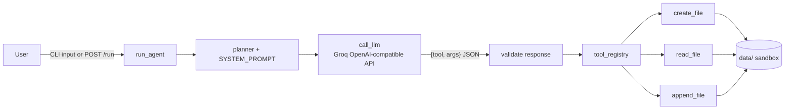

# File Agent

A small LLM-powered file agent. You describe what you want in plain English
("create file notes.txt with hello"), a Groq-hosted Llama model picks the right
tool and arguments as strict JSON, and the agent runs that tool against a
sandboxed `data/` directory. It ships as both an interactive CLI and a FastAPI
service.

Live instance (Render): <https://file-agent.onrender.com/>

## Features

- Create, read and append files using natural language
- Strict JSON tool-calling with validation of the model's output
- Path sandboxing: absolute paths and `..` traversal are rejected, all I/O stays in `data/`
- CLI (`app/main.py`) and HTTP API (`app/api.py`) entry points
- Clear errors when `GROQ_API_KEY` is missing (CLI exits, API returns `503`)
- Dockerfile (non-root, slim base) and GitHub Actions CI

## Architecture



1. The CLI or API receives a request.
2. `run_agent` builds a prompt from the system prompt and the request.
3. The LLM returns `{"tool": ..., "args": {...}}` (JSON mode is enforced).
4. The response is validated and the tool is looked up in the registry.
5. The tool runs inside `data/` and its result is returned.

## Requirements

- Python 3.10+
- A Groq API key (<https://console.groq.com/keys>)

## Setup

```bash
git clone https://github.com/Prajjawalsingh87/FILE_AGENT.git
cd FILE_AGENT
python3 -m venv .venv
source .venv/bin/activate
pip install -r requirements.txt
cp .env.example .env    # then put your GROQ_API_KEY in .env
```

| Variable | Required | Default | Purpose |
|---|---|---|---|
| `GROQ_API_KEY` | yes | — | Groq API key |
| `GROQ_MODEL` | no | `llama-3.3-70b-versatile` | Model used for tool selection |
| `LLM_TIMEOUT_SECONDS` | no | `30` | Per-request LLM timeout |
| `PORT` | no | `8000` | Port used by the Docker image |

## Run

### CLI

```bash
python app/main.py
```

```text
File Agent CLI. Type 'exit' to quit.
>>> create file todo.txt with buy milk
Created file: todo.txt
>>> read todo.txt
buy milk
```

### API

```bash
uvicorn app.api:app --reload --port 8000
```

Interactive docs: <http://localhost:8000/docs>

```bash
curl -s http://localhost:8000/health
curl -s -X POST http://localhost:8000/run \
  -H 'Content-Type: application/json' \
  -d '{"user_input": "read notes.txt"}'
```

### Docker

```bash
docker build -t file-agent .
docker run --rm -p 8000:8000 --env-file .env file-agent
```

## API reference

| Method | Path | Description |
|---|---|---|
| `GET` | `/` | Liveness message: `{"message": "File Agent Running 🚀"}` |
| `GET` | `/health` | `{"status": "ok", "llm_configured": true/false}` |
| `POST` | `/run` | Body `{"user_input": "..."}` → `{"response": "..."}` |

`POST /run` still accepts the older `?user_input=...` query parameter for
backward compatibility, but the JSON body is preferred. It returns `422` when
no input is given and `503` when `GROQ_API_KEY` is not configured.

## Example commands

- `create file notes.txt with hello`
- `read notes.txt`
- `append notes.txt with world`

## Project structure

```text
FILE_AGENT/
├── app/
│   ├── agent/
│   │   ├── agent.py          # orchestration: prompt → LLM → validate → tool
│   │   ├── planner.py        # placeholder for multi-step planning
│   │   └── prompt.py         # strict JSON system prompt
│   ├── core/
│   │   ├── config.py         # env loading (.env), model settings
│   │   └── llm.py            # Groq client (OpenAI-compatible)
│   ├── tools/
│   │   ├── file_tools.py     # sandboxed create/read/append
│   │   └── tool_registry.py  # tool lookup by name
│   ├── api.py                # FastAPI app
│   └── main.py               # interactive CLI
├── data/                     # sandbox for all file operations
├── .github/workflows/ci.yml  # lint, compile, API smoke test, docker build
├── Dockerfile
├── .env.example
├── requirements.txt
└── ruff.toml
```

## Deployment (Render)

The live instance runs on Render. For a native Python web service use:

- Build command: `pip install -r requirements.txt`
- Start command: `uvicorn app.api:app --host 0.0.0.0 --port $PORT`
- Environment: set `GROQ_API_KEY` in the Render dashboard (never commit it)

Alternatively, point Render at the `Dockerfile`; it honours the `PORT` variable.
Note that files written to `data/` live on the container's ephemeral disk and
are lost on redeploy unless you attach a persistent disk.

## Troubleshooting

| Symptom | Fix |
|---|---|
| `GROQ_API_KEY is not set` / HTTP `503` | Create `.env` from `.env.example` or export the variable. |
| `Error: Tool execution failed. Error code: 401` | The key is invalid or revoked; generate a new one in the Groq console. |
| `ModuleNotFoundError: No module named 'app'` | Run commands from the repo root (`uvicorn app.api:app`, `python app/main.py`). |
| `Error: LLM returned invalid JSON` | Rephrase the request; the model occasionally ignores JSON mode. |
| `Unsafe paths are not allowed` | Use a plain relative file name; `..` and absolute paths are blocked by design. |
| `422` from `/run` | Send `Content-Type: application/json` with a `user_input` field. |

## Safety notes

- File reads and writes are limited to `data/`.
- `.env` is git-ignored; never commit API keys.
- The container runs as an unprivileged user.
